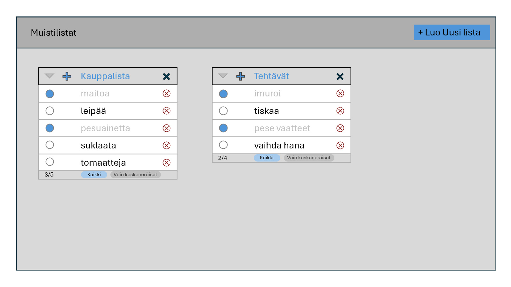
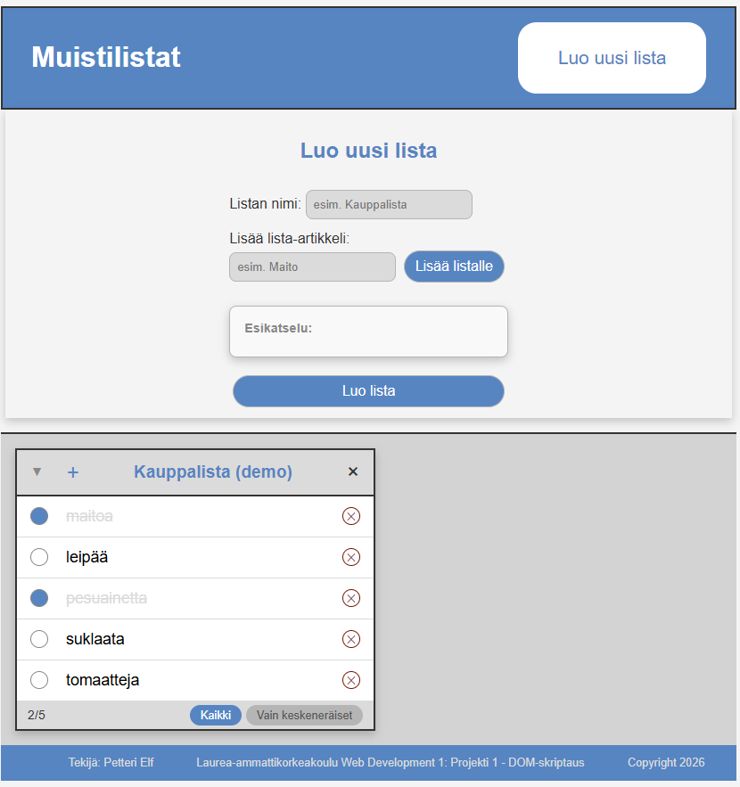

# Projektin nimi

**Tekijä:** Petteri Elf

## Projektisuunnitelma

### Projektin idea

- Kuvaile lyhyesti, mitä sovelluksesi tekee ja kenelle se on tarkoitettu.

Sovelluksella voidaan luoda, muokata ja tarkastella listoja, joiden aiheet ovat vapaavalintaisia. 
Esimerkiksi kauppalistoja, deadline listoja, bongattuja eläimiä, jne.
Se on suunnattu itselleni ja kaikille, jotka tarvitsevat muistilistoja.

### Suunnitellut toiminnot

Listaa vähintään kolme sovellukseesi suunniteltua toimintoa:

- Uusien listojen luominen ja nimeäminen
- Listojen ja niiden sisällön lisääminen ja poistaminen
- Listojen tallentaminen
- Listassa olevien asioiden määrän ilmaisu numeroin
- Listan sisällön suodattaminen

### Rautalankamalli / luonnos

Lisää tähän kuva käsin piirtämästäsi tai digitaalisesti tehdystä sovelluksen luonnoksesta. Luonnoksessa tulee näkyä sovelluksen pääasiallinen näkymä ja tärkeimmät elementit.

Esimerkki kuvan lisäämisestä:

## Verkkolinkit

- **Julkaistu sovellus:** [Lisää tähän GitHub Pages -osoite](https://yourusername.github.io/your-repository/)
- **GitHub-repositorio:** [Lisää tähän repositorion osoite](https://github.com/yourusername/your-repository)
- **Projektin videoesittely:** [Lisää tähän videon osoite](https://example.com/)

## Tietoja sovelluksesta

**[Muistilistat]** on verkkosovellus, jolla (olisi pitänyt) voi luoda muistilistoja erilaisiin tarkoituksiin ja teemoihin. Sovelluksessa uusi lista luodaan lomakkeen avulla, joka avataan oikeassa yläkulmassa olevalla painikkeella, jossa määritellään listan otsikko omaan kenttäänsä, sekä listalle merkittävät asiat. Listan sisältö tulee näkyviin esikatselunäkymään lomakkeeseen. Lista luodaan painikkeella. Listan sisältöä voi merkitä valmiiksi vasemassa reunassa olevalla painikkeella, kullakin rivillä, ja poistaa oikealla puolella olevasta punaisesta raksista, rivikohtaisesti. Listassa on myös mahdollisuus luoda uusia rivejä, minimoida lista, tai poistaa se. 
Listassa on laskin, joka ilmaisee keskeneräiset askareet ja kokonaismäärän lukuna vasemmassa alalaidassa, sekä suodattimet, joilla voi piilottaa tehdyt listan osiot. 

Kuvaile lyhyesti sovelluksen tarkoitus ja tärkeimmät toiminnot.

## Teknologiat

Kuvaile, mitä teknologioita käytit ja mikä niiden rooli oli projektissasi.

- HTML – sivun rakenne
- CSS – ulkoasu ja asettelu
- JavaScript – toiminnallisuus, DOM-skriptaus ~~ja lomakkeiden validointi~~
- ~~localStorage – tietojen tallentaminen selaimeen, jos käytit sitä~~

## Sovelluksen käyttö

Kirjoita lyhyet käyttöohjeet sovellukselle.

1. Avaa julkaistu sovellus yllä olevasta linkistä.
2. ~~Täytä lomakkeen kentät.~~
3. ~~Lisää, muokkaa, poista tai merkitse kohteita tehdyiksi.~~
4. ~~Päivitä sivu ja tarkista, säilyvätkö tiedot selaimessa, jos käytit localStoragea.~~

## Sovelluksen käynnistäminen paikallisesti

1. Kloonaa tai lataa tämä repositorio omalle koneellesi.
2. Avaa projektikansio.
3. Avaa `index.html` selaimessa.

## Kuvakaappaukset

Lisää tähän vähintään yksi kuvakaappaus toimivasta sovelluksestasi.

Esimerkki kuvan lisäämisestä:

## Tunnetut virheet / puutteet

-Toiminnallisuudet, lomake kentän piilottamista lukuunottamatta jäivät toteuttamatta.

## Oma arvio ja oppimisen reflektointi

Pohdi työtäsi ja oppimisprosessiasi.

- Missä onnistuin?
    Visuaalinen ilme oli mielestäni välttävä.
- Mikä oli haastavaa?
    Aikataulutus ja DOM-skriptaus.  
- Mitä parantaisin, jos aikaa olisi enemmän?
    Konseptia pitäisi varmaan vähän hioa. Suunnittelisin lomakkeen uusiksi, ja tekisin valmiiksi kaikki toiminnallisuudet, jotka aioin toteuttaa, kuten tehty/poisto/filtteri -napit yms.
- Mitä opin HTML:stä, CSS:stä, JavaScriptistä ja DOM-skriptauksesta?
    Näiden yhteistoiminnan periaatteet, ja joitakin yksittäisiä niksejä.  
- Mikä jäi epäselväksi tai mistä haluaisin oppia lisää?
    Sisältöä on toki paljon, mutta yleisimpiä menetelmiä voisi opetella vähän enemmän, niinkuin tässä käytiinkin.
- Oma arvio projektista: **1/10 pistettä**

## Lähteet ja kiitokset

Listaa kaikki projektissa käyttämäsi lähteet, tutoriaalit, kuvat ja koodiesimerkit.
Jos käytit ChatGPT:tä, GitHub Copilotia tai muuta tekoälytyökalua, mainitse se tässä ja kerro lyhyesti, miten se tuki työskentelyäsi.

- [Lähteen tai tutoriaalin nimi]
- kurssin oppimateriaalit
- https://www.w3schools.com/
- [Kuvalähde]
- Käytetty tekoälytyökalu: Googlen hakukone AI (Gemini)
  - Miten työkalua käytettiin: Pyysin tekoälyltä apua listan rakenteen suunnitteluun konseptin pohjalta, sekä käytettyjen symboli-koodien selvitykseen, erilaisten koodaus konseptien tarkennuksiin, ja bugien selvittämiseen.

  ## Lisenssi

Tämä projekti on lisensoitu MIT-lisenssillä.

Lisätietoa lisenssin lisäämisestä GitHub-projektiin:
https://docs.github.com/en/communities/setting-up-your-project-for-healthy-contributions/adding-a-license-to-a-repository